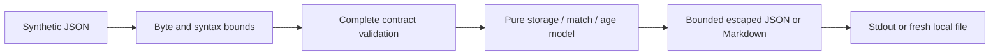

# HTTP Cache Semantics Lab

A Python standard-library teaching model for shared-cache storage, request matching,
freshness and intended sharing. It produces reasoning records from synthetic normalized
metadata. It never sends HTTP requests, stores bodies, releases content or changes a cache.

The useful distinction: an entry may be **age-fresh** yet require origin contact
because of no-cache; a private/no-store response has no available shared entry;
a different Vary value is a miss even when a strong validator is declared.

## Run locally

Python 3.13.7 on Windows was verified; no third-party runtime packages required.
From this directory:

```powershell
python -m cachelab fixtures/cases.json
python -m cachelab fixtures/cases.json --format markdown --output fresh-demo.md
python -m unittest discover -s tests -v
python -O -m unittest discover -s tests -v
python tools/verify.py --output reports/new-verification
```

The full fixture demo exits **2** because nine cases are explicitly unsupported;
it still emits all 34 reasoning records. Supported documents exit 0, including
supported negative decisions. Invalid input or I/O failure exits 1. Existing output
files are rejected. The verifier additionally requires the already installed Bandit;
it installs nothing. Use a new evidence directory for each verification run.

Python API:

```python
from pathlib import Path
from cachelab import parse, evaluate

report = evaluate(parse(Path("fixtures/cases.json").read_bytes()))
print(report["results"][0]["proposed_action"])  # REUSE
```

Library entry points reject custom objects/generators and apply the same contract
bounds. `parse()` decodes bounded bytes; `evaluate()` validates the entire schema.
Reporter helpers expect evaluated reports; they are not separate untrusted-data APIs.

## Demo and design

| Frozen case | Age-fresh | Shared storage | Proposed action |
|---|---|---|---|
| fresh | true | true | REUSE |
| no-cache-validator | true | true | CONDITIONAL_VALIDATION |
| private | true | false | FETCH_REQUIRED |
| expiry-equality | false | true | FETCH_REQUIRED |
| variant-different | true | true | FETCH_REQUIRED |
| auth-original | unknown | unknown | UNSUPPORTED |

Generated [JSON](reports/verification-reviewed/demo.json) and
[Markdown](reports/verification-reviewed/demo.md) include assumptions, reasons,
declared intent and the deliberately unsafe teaching comparator. Caller-declared
intent does not authenticate sharing authority. A reusable response with false intent
illustrates misconfiguration; it is not evidence of an actual data leak.



[CONTRACT.md](CONTRACT.md) freezes exact fields, URI/header grammar, status codes,
reason precedence and null meanings. [PLAN.md](PLAN.md) records approved scope.
[RESEARCH.md](RESEARCH.md) compares actual CacheControl/requests-cache source and the
retry-ambiguity alternative. Main protocol reference:
[RFC 9111](https://www.rfc-editor.org/rfc/rfc9111.html).

## Security model and limitations

Only anonymous complete GET/200 metadata, explicit normalized lifetimes, declared
corrected initial age and a synthetic x-variant selector are supported. Auth/cookie
presence (even empty) in every represented message is unsupported. Freshness uses
synthetic time and no sleeps. A proposed validation is never a successful validation.

No raw HTTP grammar, live origin, 304 merge, authentication implementation, private
cache, persistence, concurrent cache, heuristic freshness, content negotiation or
complete RFC/browser conformance. URI scope is restricted to reserved .test/.example
hosts with no percent encoding, ports or resolution; supported query distinctions
are preserved exactly. Negative subset decisions do not establish actual access rights.

Input/output/depth/numeric/schema bounds and inert reports protect the teaching
interface. They do not provide a hard OS resource boundary. Caller-selected paths
are trusted; hostile filesystem races, special files and process termination are
outside the isolation model. Stdout can be partial on I/O failure. Fresh-file errors
attempt honest cleanup, not an atomic durability guarantee.

## Verified results and learning

21 tests pass in normal and optimized Python; 34 independent frozen scenarios
(25 supported, nine unsupported); syntax checks; Bandit zero findings/errors with
four narrow fixed-command test/verifier suppressions. Three deliberate source
regressions produced expected fixture failures (3/2/2), followed by byte restoration
and passing tests. [Verification](VERIFICATION.md) records exact evidence/limits;
[ECC review](REVIEW.md) is implementing-agent self-review, not independent assurance.
Manual security-boundary review remains pending. No Linux, hosted CI/CodeQL,
production cache, browser or live HTTP behavior was tested. No repository was initialized,
published or merged; the unrelated parent repository was preserved.

[LEARNING.md](LEARNING.md) explains storage versus reuse, age versus permission,
and independent test labels. [DECISIONS.md](DECISIONS.md) records design tradeoffs.
Optional exercise: explain why no-cache-validator and variant-different both contact
the origin but propose different actions.

## License and assistance

MIT, copyright 2026 Jake. Original code; bounded JSON parsing/reporting patterns reuse
Jake's MIT CORS lab ideas, with its records preserved. No upstream CacheControl or
requests-cache code copied. Their licenses/dependencies are reviewed in RESEARCH.md.
Codex implemented/reviewed/tested this lab. Installed local Ollama qwen3.5:2b extracted
three supplied definitions during planning (558 ms); it did not make security decisions,
generate the frozen oracle or independently verify sources. No remote worker or paid call.

## Publication status

See [publication review](PUBLICATION.md) for the October 5 source snapshot, fresh local checks, evidence boundaries and current hosted-check distinction.
